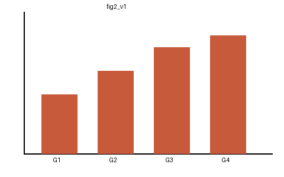

# Abstract

**Background and Aims:** Colonoscopy quality varies between endoscopists. We evaluated whether a training program improves adenoma detection.

**Methods:** We conducted a retrospective cohort study at two hospitals from 2015 to 2020.

**Results:** Among 4,512 colonoscopies, the adenoma detection rate increased from 28.1% to 34.6%.

**Conclusions:** The training program was associated with improved detection.

# Introduction

Colorectal cancer is the third most common cancer worldwide.[1] Adenoma detection rate (ADR) is a key quality indicator.[2,3]

Several interventions have been proposed to improve ADR, but evidence remains limited.

# Methods

## Study design

This retrospective study was approved by the institutional review board.

## Outcomes

The primary outcome was ADR. Secondary outcomes included sessile serrated lesion detection rate.

# Results

| Variable | Before | After |
|---|---|---|
| Colonoscopies, n | 2,201 | 2,311 |
| ADR, % | 28.1 | 34.6 |

# Discussion

Our findings suggest that structured training improves ADR.

This study has some limitations. First, it was retrospective.
